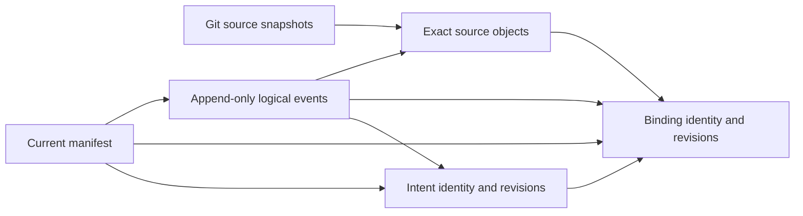

# Architecture

Git remains the source-code store and atomic packaging mechanism. Intent is an independent object, bindings independently version applicability, and events describe explicit transformations. None is identified by a commit, function, or line number.

`tools/intentlib/core.py` owns serialization, Git snapshots, stores, and validation. `schema.py` defines both published schemas and their supported runtime schema subset. `cli.py` provides draft construction, record finalization, queries, installation, and Git transaction adapters. `tools/intentctl.py` is the portable entry point.

## Independent histories

An intent revision does not require a source modification. Bindings reference a stable intent identity AND its exact assessed revision. Advancing the intent leaves existing binding pins untouched, making reassessment observable. Ending one binding does not retire its intent. A retired intent keeps every historical record, but cannot retain active applicability.

Every revision names its originating event and predecessor hash. Events own revisions by explicit references. The manifest lists latest heads and a causal append order for events. It is a derived selection/index with a strictly validated shape: it cannot hide revisions or events. Records themselves remain canonical history.

Events carry exact per-file before/after states and changed intervals. Several events can occur before one commit, including returning source to its initial bytes. Capture stage 1, finalize, stage stage 2, capture and finalize again, then commit together. Every intermediate source object is retained as base64 JSON. Events may span any number of files or contain no source changes.

Finalization validates a hypothetical complete index before writing records. Per-file replacement is atomic; a filesystem/process failure between record writes can leave an incomplete uncommitted transaction. Validation fails closed. Preserve the draft, remove ONLY its uncommitted partial outputs, restore its prior manifest, and finalize again. Finalization is not a multi-file filesystem transaction, and the CLI does not support concurrent writers in one worktree.

## Code identity and refactoring

V1 deliberately implements explicit binding continuity rather than persistent fragment identity. Exact snapshot fingerprints establish what bytes were targeted, not logical equivalence. No inferred movement authorizes a transition.

A binding revision can move its target; `predecessors` on new bindings represent copy/split/consolidation lineage. Several successors may name one predecessor, or one successor may name several. End old applicability explicitly where appropriate. Retaining an old active binding is an explicit representation of copying rather than moving.

All bindings in a changed file require new snapshots and explicit declarations, even when an edit occurs elsewhere. This is conservative and noisy, but deterministic and safe against silent positional drift. A future mapping engine may suggest successor ranges; declarations must remain authoritative.

## Why separate records?

Commit messages cannot independently version several intents or bindings, and squash operations collapse their packaging. Git notes are useful annotations but are not normally fetched, reviewed, and atomically committed with source. Comments couple intent storage to source placement and cannot express arbitrary overlapping applicability without changing code. Ordinary specifications remain useful context, but lack enforced region references and explicit transition accounting.

These records supplement all four mechanisms. They preserve independently evolving identities with reviewable, deterministic transitions.

## Extensions

A parser adapter may propose symbols/ranges but cannot assert continuity. Verification evidence has kind/reference/result fields; an independent verifier can inspect an event and publish later evidence through a metadata-only event. Signatures and attestations can reference content hashes without changing object identity. A derived interval/graph database may accelerate queries but must regenerate completely from Git and canonical JSON.
